---

## 🧑‍💻 About me

I'm a full-stack software developer who loves building things that look good and feel nice to use. These days I also work a lot with AI, and I especially love building MCP servers 🤖 that connect AI assistants to real tools and data. When I'm not coding, you'll find me hanging out with cats 🐈, playing video games 🎮, drawing ✏️ or watching anime 🌸. Yes, I'm a cat person, and yes, my weather app is called PurrCast.

- 🔭 Working as a **Software Developer** at **EXP Software GmbH**
- 🤖 Building with AI: I love making **MCP (Model Context Protocol) servers**
- 🌱 Currently learning **Java, CI/CD and Docker**
- 👩‍💻 Projects live [here on GitHub](https://github.com/kchaumeow?tab=repositories) and on [my personal page](https://about-me-kchaumeow.vercel.app/)
- 📫 Reach me at **atrofimova516@gmail.com**
- 🎨 Outside of code: **cats, video games, drawing and anime**
- 🗣️ Languages: **English (C1), Russian (native), German (A2)**
- ⚡ Fun fact: I think I'm funny

## 🛠️ Tech stack

<b>Learning now</b>

FRAMEWORKS &amp; TOOLS

PROJECTS

🎬 <a href="https://github.com/kchaumeow/cinema-search">cinema-search</a> ·
🔌 <a href="https://github.com/kchaumeow/dev-proxy">dev-proxy</a> ·
🐱 <a href="https://github.com/kchaumeow/PurrCast">PurrCast</a> ·
🌸 <a href="https://github.com/kchaumeow/AnimeHub">AnimeHub</a> ·
🌍 <a href="https://github.com/explore-de/pruefstein">pruefstein</a> ·
🌍 <a href="https://github.com/explore-de/Treasure">Treasure</a>

**🌍 Open source:** I contribute to [pruefstein](https://github.com/explore-de/pruefstein), device compliance management for ISO 27001, working on the agent CLI and the UI. And also to [treasure](https://github.com/explore-de/Treasure), company devices management system.

<a href="https://about-me-kchaumeow.vercel.app/projects" target="_blank"><b>See all my projects on my portfolio →</b></a>

## 📊 GitHub stats

